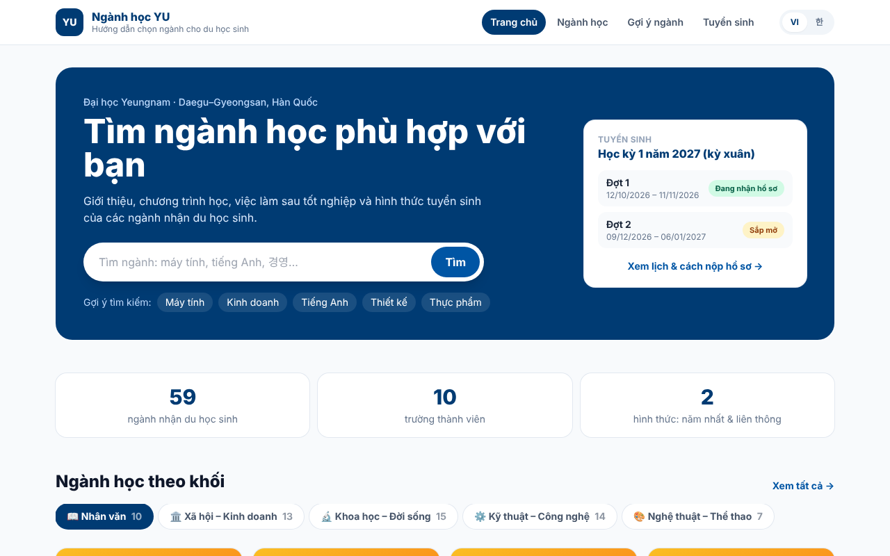
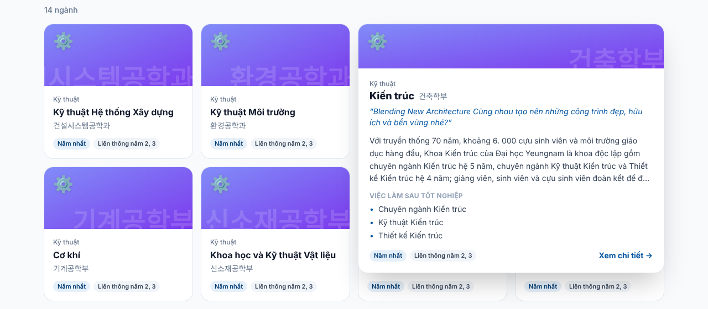
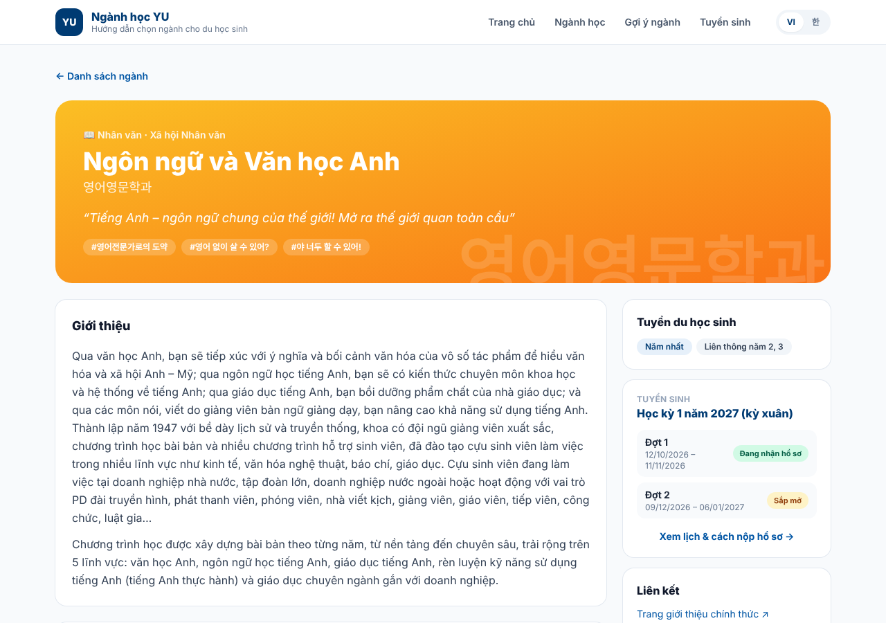
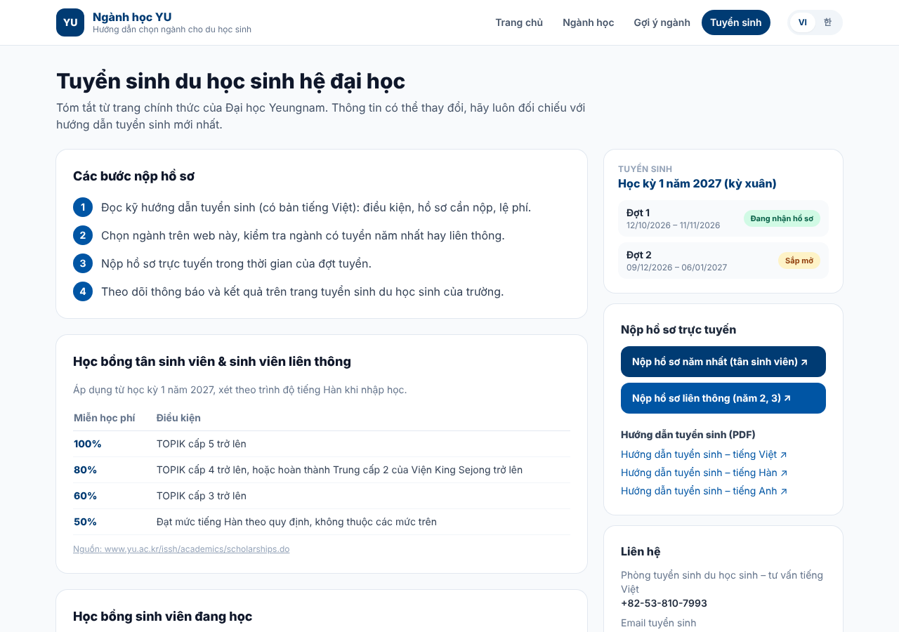
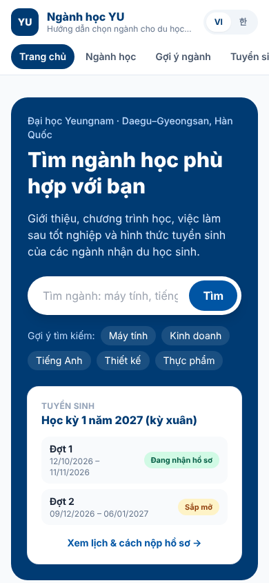

# Ngành học YU — Hướng dẫn chọn ngành cho du học sinh Đại học Yeungnam

Web tĩnh song ngữ **Việt – Hàn** giúp du học sinh (trước hết là sinh viên Việt Nam) tìm hiểu **59 ngành** nhận du học sinh của Đại học Yeungnam (영남대학교), so sánh, nhận gợi ý ngành và xem lịch tuyển sinh.

🔗 **Xem web:** https://xuandieu68.github.io/yu-majors-mini/

> Dự án học tập, **không phải trang chính thức** của Đại học Yeungnam. Nội dung ngành học © Yeungnam University. Luôn đối chiếu thông tin tuyển sinh với trang chính thức của trường.



---

## Mục lục

- [Tính năng](#tính-năng)
- [Công nghệ](#công-nghệ)
- [Nguồn dữ liệu](#nguồn-dữ-liệu)
- [Cấu trúc thư mục](#cấu-trúc-thư-mục)
- [Chạy trên máy](#chạy-trên-máy)
- [Triển khai lên GitHub Pages](#triển-khai-lên-github-pages)
- [Bảo trì: cập nhật dữ liệu](#bảo-trì-cập-nhật-dữ-liệu)
- [Lịch sử phát triển](#lịch-sử-phát-triển)
- [Hạn chế đã biết](#hạn-chế-đã-biết)
- [Hướng phát triển tiếp](#hướng-phát-triển-tiếp)
- [Ghi công](#ghi-công)

## Tính năng

| Trang | Địa chỉ | Nội dung |
|---|---|---|
| Trang chủ | `#/` | Ô tìm kiếm, từ khóa gợi ý, lịch tuyển sinh tự đổi trạng thái theo ngày, số liệu tổng quan, danh sách ngành theo 5 khối |
| Ngành học | `#/departments` | Tìm kiếm không dấu bằng tiếng Việt hoặc tiếng Hàn; lọc theo khối, trường thành viên, hình thức tuyển. Bộ lọc được lưu trên địa chỉ trang nên có thể gửi link kết quả cho người khác |
| Chi tiết ngành | `#/department/<id>` | Giới thiệu, chuyên ngành, chương trình học theo từng năm, việc làm sau tốt nghiệp, chứng chỉ, hoạt động, hình thức tuyển, liên kết chính thức, các ngành cùng trường |
| Gợi ý ngành | `#/recommend` | 3 câu hỏi → khối ngành phù hợp nhất và danh sách ngành của khối đó |
| Tuyển sinh | `#/admissions` | Các bước nộp hồ sơ, lịch các đợt, link nộp online, hướng dẫn tuyển sinh (PDF), học bổng, chuẩn TOPIK để tốt nghiệp, liên hệ. Mọi mục đều ghi nguồn |

**Thẻ xem nhanh khi rê chuột.** Trên máy tính, rê chuột lên thẻ ngành 0,25 giây sẽ mở một thẻ rộng gấp đôi gồm khẩu hiệu, phần giới thiệu, việc làm và hình thức tuyển. Thẻ tự mở sang trái nếu nằm sát mép phải màn hình. Trên điện thoại, chạm vào thẻ sẽ vào thẳng trang chi tiết.



**Song ngữ Việt – Hàn.** Nút **VI / 한** ở góc trên đổi toàn bộ giao diện và dữ liệu ngành. Web ghi nhớ ngôn ngữ đã chọn cho lần sau.

**Giao diện thích ứng.** Máy tính hiển thị 4 cột, máy tính bảng 3 cột, điện thoại 2 cột và menu cuộn ngang.

| Chi tiết ngành | Tuyển sinh | Điện thoại |
|---|---|---|
|  |  |  |

## Công nghệ

| Thành phần | Vai trò |
|---|---|
| [React 18](https://react.dev) | Chia giao diện thành các component (thẻ ngành, thẻ lịch tuyển sinh…) |
| [Vite 5](https://vitejs.dev) | Chạy thử trên máy, build ra HTML/CSS/JS tĩnh |
| [Tailwind CSS 3](https://tailwindcss.com) | Viết giao diện bằng class tiện ích |
| [React Router 6](https://reactrouter.com) (`HashRouter`) | Nhiều trang trong một web. Địa chỉ dạng `#/...` để GitHub Pages không báo 404 khi tải lại trang |
| React Context | Song ngữ, không cần thư viện ngoài (`src/i18n.jsx`) |
| Python 3 | Chuẩn hóa dữ liệu ngành (`scripts/prepare_data.py`) |
| GitHub Actions + GitHub Pages | Tự build và đưa lên mạng mỗi lần push lên `main`. Hosting miễn phí |

Web không có máy chủ, không có cơ sở dữ liệu và không gọi API trả phí. Toàn bộ dữ liệu là file JSON tĩnh.

## Nguồn dữ liệu

| Dữ liệu | Nguồn | Nằm ở |
|---|---|---|
| 59 ngành nhận du học sinh (giới thiệu, chương trình học, việc làm, chứng chỉ, hình thức tuyển) | Trang các ngành của trường: [yu.ac.kr/main/academics](https://www.yu.ac.kr/main/academics/university.do). Bản thu thập và dịch tiếng Việt lấy từ dự án mở [yu-vn-majors](https://github.com/22600410-ui/yu-vn-majors) | `data/source-departments.json` → `public/data/departments.json` |
| Lịch tuyển sinh, link nộp hồ sơ, hướng dẫn tuyển sinh PDF, liên hệ | [Phòng tuyển sinh du học sinh – yu.ac.kr/isa](https://www.yu.ac.kr/isa/index.do) | `src/data/admissions.json` |
| Học bổng tân sinh viên và sinh viên đang học | [Trung tâm hỗ trợ du học sinh – Scholarships](https://www.yu.ac.kr/issh/academics/scholarships.do) | `src/data/admissions.json` |
| Chuẩn tiếng Hàn để tốt nghiệp | [Trung tâm hỗ trợ du học sinh – thông báo](https://www.yu.ac.kr/issh/) | `src/data/admissions.json` |

- Dữ liệu ngành: cập nhật ngày **09/11/2026**, giá trị này ghi trong trường `updatedAt`.
- Thông tin tuyển sinh: kiểm tra lần cuối ngày **09/11/2026**, ghi trong trường `checkedAt`.

## Cấu trúc thư mục

```
yu-majors-mini/
├─ .github/workflows/deploy.yml   # Build + deploy lên GitHub Pages mỗi lần push lên main
├─ data/
│  └─ source-departments.json     # ★ Dữ liệu ngành gốc (đầu vào của script)
├─ scripts/
│  └─ prepare_data.py             # Làm phẳng, gán khối ngành, làm sạch văn bản
├─ public/data/departments.json   # Dữ liệu web tải về (do script tạo, không sửa tay)
├─ docs/images/                   # Ảnh chụp màn hình cho README
├─ index.html                     # Khung HTML, font chữ
├─ vite.config.js                 # ★ base: '/<tên-repo>/'
├─ tailwind.config.js             # Màu thương hiệu `yu`, font chữ
└─ src/
   ├─ main.jsx                    # Điểm khởi đầu, bọc App trong LangProvider
   ├─ App.jsx                     # Header, nút đổi ngôn ngữ, định tuyến, footer
   ├─ i18n.jsx                    # ★ Chữ trên giao diện (vi, ko) + hàm L({vi, ko})
   ├─ index.css                   # Tailwind + hiệu ứng mở thẻ xem nhanh
   ├─ data/
   │  ├─ fields.json              # ★ 5 khối ngành: tên, biểu tượng, màu
   │  ├─ recommend.json           # ★ Câu hỏi gợi ý ngành và điểm cộng cho từng khối
   │  └─ admissions.json          # ★ Thông tin tuyển sinh (có nguồn)
   ├─ hooks/useDepartments.js     # Tải dữ liệu ngành một lần, các trang dùng chung
   ├─ utils/
   │  ├─ text.js                  # Bỏ dấu tiếng Việt, cắt câu
   │  └─ schedule.js              # Trạng thái đợt tuyển theo giờ Hàn Quốc, định dạng ngày
   ├─ components/
   │  ├─ DepartmentCard.jsx       # Thẻ ngành + thẻ xem nhanh khi rê chuột
   │  ├─ Thumb.jsx                # Ảnh minh họa tự tạo (màu khối + biểu tượng)
   │  ├─ AdmissionBadges.jsx      # Nhãn "Năm nhất" / "Liên thông năm 2, 3"
   │  └─ RoundsCard.jsx           # Thẻ lịch tuyển sinh
   └─ pages/                      # Home, Departments, DepartmentDetail, Recommend, Admissions
```

★ là các file người quản lý web thường sửa.

## Chạy trên máy

Cần cài [Node.js](https://nodejs.org) 20 trở lên và [Git](https://git-scm.com). Muốn chạy lại script dữ liệu thì cần thêm Python 3.

```bash
git clone https://github.com/xuandieu68/yu-majors-mini.git
cd yu-majors-mini
npm install          # cài thư viện (lần đầu)
npm run dev          # chạy thử, mở http://localhost:5173/yu-majors-mini/
npm run build        # build ra thư mục dist/
npm run preview      # xem thử bản build
```

## Triển khai lên GitHub Pages

Việc triển khai diễn ra tự động: mỗi lần push lên nhánh `main`, workflow `.github/workflows/deploy.yml` sẽ cài thư viện, chạy `npm run build` rồi đưa thư mục `dist/` lên GitHub Pages. Tiến trình xem ở tab **Actions**, thường mất khoảng 30 giây.

Nếu bạn tạo bản sao của dự án:
1. **Settings → Pages → Build and deployment → Source**: chọn **GitHub Actions**. Việc này chỉ cần làm một lần.
2. Nếu đặt tên repository khác `yu-majors-mini`, sửa `base` trong `vite.config.js` cho trùng tên repository. Nếu không, web sẽ hiện trang trắng.

## Bảo trì: cập nhật dữ liệu

### Trước mỗi kỳ tuyển sinh (quan trọng)

Mở `src/data/admissions.json`, đối chiếu với [yu.ac.kr/isa](https://www.yu.ac.kr/isa/index.do) và [yu.ac.kr/issh](https://www.yu.ac.kr/issh/academics/scholarships.do), rồi cập nhật:
- `term`, `rounds` (ngày bắt đầu, ngày kết thúc, giờ hết hạn). Thẻ lịch sẽ tự hiện **Đang nhận / Sắp mở / Đã kết thúc**.
- `applyLinks`, `guides`: link nộp hồ sơ và file hướng dẫn của kỳ mới (thường đổi theo năm).
- `freshmanScholarships`, `currentScholarships`, `graduation`: nếu trường thay đổi quy định.
- `checkedAt`: ngày bạn kiểm tra.

### Cập nhật hoặc thêm ngành

Không sửa tay `public/data/departments.json`, vì file này do script tạo ra. Thay vào đó:

```bash
# 1. Thay data/source-departments.json bằng bản mới
#    (ví dụ tải lại từ https://github.com/22600410-ui/yu-vn-majors/blob/main/public/data/departments.json)
# 2. Tạo lại dữ liệu cho web
python3 scripts/prepare_data.py      # in ra: "59 ngành -> public/data/departments.json"
```

Ngành bị xếp sai khối thì sửa `COLLEGE_FIELD` hoặc `OVERRIDES` trong `scripts/prepare_data.py`.

### Sửa chữ trên giao diện hoặc thêm ngôn ngữ

- Chữ trên giao diện nằm trong `UI.vi` và `UI.ko` ở `src/i18n.jsx`.
- Muốn thêm ngôn ngữ: thêm một bộ chữ mới vào `UI`, thêm nút vào `LanguageSwitcher` trong `src/App.jsx`, và bổ sung ngôn ngữ đó vào dữ liệu. Ngôn ngữ nào thiếu bản dịch, hàm `L()` sẽ tự lấy tiếng Hàn rồi đến tiếng Việt.

### Sửa câu hỏi gợi ý ngành

Sửa `src/data/recommend.json`. Mỗi đáp án có `score` là số điểm cộng cho từng khối (`humanities`, `social`, `science`, `engineering`, `arts`).

## Lịch sử phát triển

Dự án được xây dựng từng bước, mỗi bước là một commit. Bạn có thể đọc lại ở mục [Commits](https://github.com/xuandieu68/yu-majors-mini/commits/main) để học:

| Bước | Nội dung |
|---|---|
| 1 | Khởi tạo: React + Vite + Tailwind, 15 ngành mẫu, 4 trang, workflow deploy |
| 2 | Dữ liệu: đủ 59 ngành, thêm script chuẩn hóa dữ liệu |
| 3 | Song ngữ Việt – Hàn |
| 4 | Giao diện mới và thẻ xem nhanh khi rê chuột |
| 5 | Trang Tuyển sinh, lấy từ nguồn chính thức |
| 6 | README hoàn chỉnh và ảnh chụp màn hình |

## Hạn chế đã biết

- **Điều kiện đầu vào** (TOPIK tối thiểu, hồ sơ cần nộp, lệ phí) chỉ có trong file PDF hướng dẫn tuyển sinh. Web dẫn link tới file đó, không chép lại số liệu.
- **Danh sách ngành áp dụng TOPIK 3 khi tốt nghiệp** mới ghi các ví dụ. Danh sách đầy đủ xem trong thông báo của trường.
- Một số ngành gồm nhiều chuyên ngành (ví dụ Khoa học Máy tính) chưa có phần giới thiệu chung trên trang nguồn. Với những ngành này, web hiển thị danh sách chuyên ngành thay cho phần giới thiệu.
- Bản dịch tiếng Việt lấy từ dự án nguồn. Một số tên gọi chưa thống nhất, ví dụ 인문대학 (Trường Nhân văn) được dịch là "Xã hội Nhân văn". Muốn sửa thì sửa trong `data/source-departments.json`, rồi chạy lại script.
- Ảnh minh họa của ngành do web tự tạo. Web không dùng ảnh của trường vì bản quyền thuộc về trường.

## Hướng phát triển tiếp

- [ ] Trang **FAQ** (câu hỏi thường gặp về hồ sơ, TOPIK, ký túc xá…)
- [ ] **Bài test tính cách** chọn ngành, chi tiết hơn bộ 3 câu hỏi hiện có
- [ ] **Chatbot** gợi ý ngành chạy theo luật (không tốn phí API)
- [ ] **Tự động cập nhật dữ liệu ngành** bằng GitHub Actions chạy theo lịch hằng tuần
- [ ] So sánh 2–3 ngành cạnh nhau
- [ ] Ảnh giới thiệu (Open Graph) khi chia sẻ link lên Facebook/Zalo

## Ghi công

- Nội dung ngành học và thông tin tuyển sinh: © [Yeungnam University](https://www.yu.ac.kr).
- Dữ liệu ngành đã thu thập và bản dịch tiếng Việt: dự án [yu-vn-majors](https://github.com/22600410-ui/yu-vn-majors). Ý tưởng giao diện, gồm cả thẻ xem nhanh, cũng tham khảo từ dự án này.
- Xây dựng với sự hỗ trợ của Claude (Anthropic).
